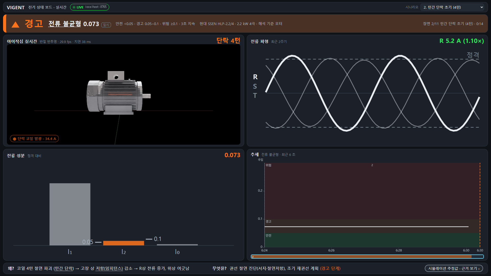

# 전기 상태 보드 레이아웃 A — 실시간 전용 + 아이작심 뷰포트 스트림 (2026-10-27)

사용자 결정(확정): 대시보드는 **실시간 전용·전기 해석 전용**. 녹화·전문가·기계·발표 모드는 UI 에서 제거(코드는 `dashboard/src/_legacy/`, 빌드 제외, 삭제 아님).
첫 화면 = 시안 A: 헤더 → 상태 띠 → [아이작심 실시간 | 전류 파형] / [전류 성분 | 추세] → 왜·무엇을 한 줄. 아이작심 화면은 녹화본이 아니라 **실시간 스트림**이다.

## 구성 (1920×1080 · 1366×768 모두 2×2 유지, 다크 단일)

```
[헤더 40]   VIGENT  전기 상태 보드 · 실시간   ● LIVE localhost:8765          시나리오 ▾ (Isaac play_scenario)
[상태 띠 72] ▲ 경고  전류 불균형 0.073 [임시]  안전 <0.05 · 경고 0.05~0.1 · 위험 ≥0.1 · 3초 지속  현대 SSEN HLP-2.2/4 · 2.2 kW 4극     장면 2/11 턴간 단락 초기 (4턴) · 0:14
[2×2]  ┌ ① 아이작심 실시간  반절 반투명 · 30 fps · 지연 33 ms   단락 4턴 ┐ ┌ ② 전류 파형 최근 2주기  결함상 굵게 · 정격 점선   R 5.2 A (1.10×) ┐
       │   <canvas> JPEG 스트림, ● 단락 코일 발광 · 34.4 A                │ │                                                              │
       └ ③ 전류 성분 I₁·I₂·I₀ 막대 (정격 대비), I₂ 눈금 0.05·0.1  0.073  ┘ └ ④ 추세 전류 불균형 (임계 띠 + 주입 세로선 + 장면 색 띠)      ┘
[하단 44]   왜? 코일 4턴 절연 파괴(턴간 단락) → … | 무엇을? 권선 절연 진단(서지·절연저항)… (경고 단계) |   시뮬레이션 추정값 · 근거 보기 ›
```

- 상태 띠 색은 config 상태 셋(초록 `#26f259` / 주황 `#ff731a` / 빨강 `#ff140d`, `index.json colors`) + ●▲■. 상태 36 px · 큰 숫자 24 px · 본문 14 px(1366×768 는 ×0.85).
- 근거 서랍(우측 560 px): 탭 **근거**(정직성 4줄·해석 근거 비교(시뮬값 있는 행만)·근거 사슬·한계 — 기존 `EvidenceDrawer`/`AnalysisRef` 재사용) · **임계값** · **사양** · **용어**.
- 데이터는 전부 Isaac state(10 Hz, `app/live_bridge.py`) + `public/data/fleet/index.json`(임계값·색·라벨·사양). 판정(status·cause)은 Isaac 쪽 `engine/thresholds.py Judge` 결과 그대로 — 대시보드는 판정하지 않는다.
- 라이브 전용이라 ▶/⏸·`?t=`·장면 칩·녹화 재생 UI 가 없다. Isaac 이 꺼져 있으면 상태 띠는 `—`(중립 회색) + "Isaac Sim 연결 대기", ① 은 "아이작심 연결 끊김 — 재연결 중"(마지막 프레임 흐리게), 2 s 간격 자동 재접속.

## 스트림 방식 — 채택 이유·지연·FPS (A0 조사 → A1 실측)

| 방식 | 판단 |
|---|---|
| **(a) 뷰포트 readback → JPEG → WebSocket 바이너리** (`motor_dt_viz/viz/stream_viewport.py`) | **채택.** `omni.kit.viewport.utility.capture_viewport_to_buffer`(LdrColor RGBA8, 추가 렌더 없음) → 메인 스레드 콜백은 numpy 복사만 → 인코더 스레드(cv2 JPEG q80, 1280×720) → asyncio 서버가 모든 클라이언트에 방송. 포트 `config/live.yaml server.stream_port: 8766`(한 줄 추가), **127.0.0.1 바인딩, 인증 없음 → 방화벽 열지 않음**. 클라이언트가 없으면 캡처 자체를 안 한다. 프레임 = 32 B 헤더(`VGF1`, 캡처 벽시계, t_session, w, h, seq) + JPEG → 브라우저가 (수신 − 캡처) 로 지연을 바로 잰다. |
| (b) Replicator rgb annotator | 보류 — 렌더 프로덕트 추가 시 GPU 2배, Replicator 초기화 수 초·World 루프 간섭 가능. |
| (c) WebRTC `omni.kit.livestream.webrtc 6.0.0` | 제외 — 헤드리스 전용 앱(`isaacsim.exp.full.streaming.kit --no-window`), 포트 TCP 49100 + UDP 47995~48012·49000~49007 다수(지정 외 포트 금지), 브라우저엔 NVIDIA 전용 WebRTC JS 라이브러리(오프라인 번들·버전 결합). |

브라우저(`dashboard/src/live/stream.ts`): WebSocket `arraybuffer` → `createImageBitmap(Blob)` → `<canvas>`. 디코딩 중 도착한 프레임은 마지막 것만(적체 없음). 3 s 무프레임 → lost → 2 s 재접속. 스트림 주소는 LiveBridge hello 의 `stream_ws`(없으면 state 주소의 포트만 `content/live.yaml stream_port` 로).

실측 (RTX 3070 Ti, `--preset demo` 1280×720, M1 half_translucent, `tools/live/stream_probe.py`, 원본 JSON 은 `docs/dashboard_layout_a/measure/`):

| 항목 | 값 |
|---|---|
| 스트림 fps (60 s, 1 클라이언트) | 1차 22.0(캡처 직렬) → 2차 24.8(2개 겹침, 프레임 격자 양자화) → **3차 30.0 fps**(누적 예약, 3개 겹침). 대시보드(Edge) 표시 29.7~30.6 fps |
| 프레임 지연 (수신 − 캡처 벽시계, 같은 PC) | p50 **26~29 ms** · p95 33~36 ms · max 102~143 ms. 대시보드 표시(디코딩 포함) 32~42 ms |
| Isaac FPS | 스트림 클라이언트 없음 50.8 / 1 클라이언트 47.3~55.2 (p50) → **≥ 30 유지, 영향 측정 오차 안** |
| 캡처 readback / JPEG 인코딩 | p50 14.8~17.3 ms(렌더 프레임 1개) / p50 8.3 ms(인코더 스레드, 메인 루프 밖) |
| 프레임 크기·대역 | p50 30~44 KB, 5.9~7.7 Mbps(localhost) |
| **10분 연속** (`measure/probe_600s_v3_final.json`) | 600 s · 17,969 프레임 · **29.95 fps** · 5 s 무응답 0회 · 지연 p50 31 ms / p95 39 / max 100 ms · 7.2 Mbps · state 9.9 Hz. 같은 시간에 스크린샷·V1 대조(Edge 2 창, 스트림 클라이언트 최대 2)를 돌려 Isaac FPS p50 40.1(min 38.3) — 그래도 ≥ 30 |
| 시나리오 전환 (명령 전송 → 새 장면 첫 state) | 83~194 ms (7 장면, `docs/dashboard_layout_a/v1_compare.json switch_ms`) |

실행 인자(`app/demo_integrated.py`): `--live` 면 스트림 기본 켜짐(`--no_stream`), `--stream_fps 30 --stream_size 1280 720 --stream_quality 80`, `--view`(스트림 때 기본 `half_translucent`), `--cam side`(기본 카메라 프리셋), `--judge_stream simulation`(아래).
state 에 덧붙인 필드(schema 1 유지): `sym_components_A{i1_A,i2_A,i0_A}`·`waveform_last_2cycles`(`app/live_signals.py` — export `case_signals` 와 같은 식, 테스트로 대조), `perf.stream`; hello 에 `stream_ws`·`stream`·`scenes`.

## 판정 정책 — `--judge_stream simulation` (판단 사항)

Isaac `--live` 데모는 2026-10-21 P1 규칙대로 Judge 스트림 라벨을 `live` 로 두어 provisional 지표(I₂/I₁)가 **advisory**(종합 판정 제외)였다. 그래서 1차 스크린샷에서 4턴·12턴이 "안전"으로 떴다.
이 보드의 데이터는 실측이 아니라 Isaac **합성 신호**이므로 배치 verify(V1 표)와 같은 `simulation` 정책(종합 포함 + "임시" 라벨)으로 판정하도록 `--judge_stream simulation` 인자를 추가했다. 기본값 `auto`(= 기존 동작)는 그대로이고 `config/thresholds.yaml judgment.provisional_policy` 도 불변 — **어느 정책을 쓸지는 실행 인자로 고르는 것**이며, 실측 스트림이 붙으면 `live` 로 돌린다.

## 7 시나리오 숫자 대조 (A3) — `tools/live/verify_live_vs_v1.py` → `docs/dashboard_layout_a/v1_compare.md`

라이브 state 를 V1 검증 로그(`logs/verify/electrical_a0/state.csv`, 장면 끝 행)와 비교. 장면 전환은 대시보드와 같은 `play_scenario {scene: n}`, 장면 경과 10 s 뒤 비교.

| 장면 | 판정 (라이브 = V1) | I₂/I₁ 편차 | I₂/I_n | I_f | P_loop |
|---|---|---|---|---|---|
| healthy | SAFE | 0.000 % | 0.000 % | — | 0.000 % |
| itsc_4turn | WARN/i2i1 | −0.028 % | −0.040 % | 0.000 % | 0.000 % |
| itsc_8turn | DANGER/i2i1 | +0.018 % | −0.005 % | 0.000 % | −0.002 % |
| itsc_12turn | DANGER/i2i1 | +0.007 % | +0.003 % | 0.000 % | +0.004 % |
| itsc_16turn | DANGER/i2i1 | −0.008 % | +0.004 % | 0.000 % | +0.003 % |
| itsc_4turn_resistive | SAFE | −0.123 %(절대 0.00004, 4자리 반올림) | +0.124 % | 0.000 % | −0.098 % |
| itsc_4turn_halfload | WARN/i2i1 | +0.010 % | −0.016 % | 0.000 % | 0.000 % |

전부 PASS(±0.1 % 또는 반올림 반 단위). 선전류 Ia/Ib/Ic 는 라이브 state 가 기존 필드대로 **0.1 A 반올림**이라 겉보기 편차 최대 1.3 %(0.05 A 안) — 대시보드도 1자리로 보여준다. 판정·원인 신호는 7/7 일치.

## 제거 목록 (→ `dashboard/src/_legacy/`)

| 제거된 것 | 코드 |
|---|---|
| 녹화/LIVE 토글·주소 입력·끊김 띠 | `live/LiveToggle.tsx` (주소는 헤더 LIVE 뱃지 클릭으로만) |
| 전문가 보기(카드·게이지 8·해석 근거 패널·하단 탭)·단순 보기 §1b·열·결함 지도 | `pages/StatusBoard.tsx`, `status/SimpleView.tsx`, `status/Gauge.tsx`, `status/tiles/MotorMap.tsx`, `status/nameplate.ts`(명판 입력 폼) |
| 기계/전기 해설 화면·발표자 화면·classic·랜딩 | `pages/{MechanicalLive,ElectricalLive,PresenterView,ModeDashboard,Landing}.tsx`, `components/*`, `elec/*.tsx`, `mech/*.tsx`, `content/*`, `live/{LiveVideoPanel,CaptionBar,LiveNarration,QaDrawer,broadcast}` |
| 제어 패널(K) | `live/ControlPanel.tsx` — 시나리오 ▾ 가 `play_scenario` 로 대체(결함 주입·부하 슬라이더는 되살릴 수 있음) |
| 발표 모드 F·단축키 Space/←→/M/K/1~9·테마 토글 | 핸들러 삭제(Esc 서랍 닫기만) |

남긴 것: `live/{feed,session,livedata,load,types,captions}.ts`, `status/{data,source,AnalysisRef,EvidenceDrawer(탭 추가),StatusStrip,TrendChart,Tabs(옮김),plain(옮김),tiles/WaveTile,tiles/BarsTile}`, `mech/data.ts`·`elec/data.ts`·`mech/colormap.ts`(livedata 의존). `tsconfig.json` `exclude: ["src/_legacy"]`, 라우트는 `#/status` 하나(`App.tsx`).

## 스크린샷 (`docs/dashboard_layout_a/img/`, `dashboard/tools/layout_a_shots.mjs`)

| | 1920×1080 | 1366×768 |
|---|---|---|
| 정상 | `healthy_1920.png` | `healthy_1366.png` |
| 4턴 경고 | `itsc_4turn_1920.png` | `itsc_4turn_1366.png` |
| 12턴 위험 | `itsc_12turn_1920.png` | `itsc_12turn_1366.png` |

근거 서랍 `drawer_evidence_1920.png` · 임계값 탭 `drawer_thresholds_1920.png` · 스트림 끊김 `stream_lost_1920.png`(`?live=ws://127.0.0.2:9` 로 재현). 첫 화면 표 0 · 게이지 0 · 그래프 2(파형·추세) 확인. 사진 속 수치는 `shots_log.json`.



## 재실행 절차

1. `cd motor_dt_viz` → `C:\ISSACS~1\python.bat app\demo_integrated.py --gui --autoplay --mode electrical --motor M1 --live --preset demo --cam side --judge_stream simulation` (PowerShell/cmd). 콘솔에 `[stream] viewport JPEG ws://127.0.0.1:8766` 가 찍힌다.
2. `cd dashboard` → `npm run build`(처음 한 번) → `node serve.cjs` → `http://localhost:4173/#/status`. 다른 PC 에서는 `?live=ws://<데스크탑 IP>:8765` — 단 ① 스트림은 127.0.0.1 전용이라 그 PC 에서는 "연결 끊김"으로 보인다(원격 노출 금지 규칙).
3. 측정: `py -3.12 -X utf8 tools/live/stream_probe.py --seconds 600 --out logs/stream_probe.json` · 숫자 대조: `py -3.12 -X utf8 tools/live/verify_live_vs_v1.py --out docs/dashboard_layout_a/v1_compare` · 스크린샷: `node tools/layout_a_shots.mjs ../docs/dashboard_layout_a/img`.

## 한계

- 뷰포트 캡처에는 omni.ui HUD 가 들어가지 않는다(기존 함정) — 숫자는 보드가 state 로 보여주므로 영향 없음.
- 스트림은 127.0.0.1 전용(결정 사항). LAN 의 다른 기기에서 ① 을 보려면 인증 있는 중계가 필요하다(범위 밖).
- JPEG 30 fps 는 1280×720 기준. 해상도를 올리면 인코딩(8 ms/720p)이 늘어난다.
- Isaac 전기 모드는 열 모델을 돌리지 않아 근거 서랍의 권선 ΔT 행은 비어 있다(`—`, 접힘).
- 추세 타일 창은 접속 후 누적(최대 `content/live.yaml window_s` 5 분) — 보드를 막 열면 "최근 6 초".
