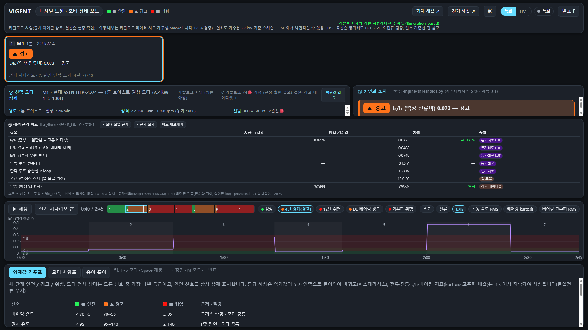
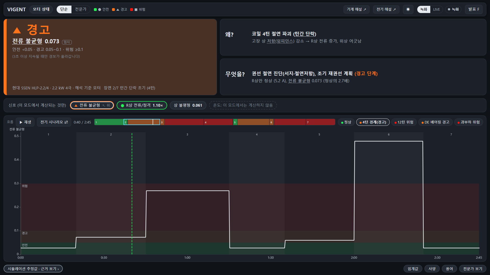
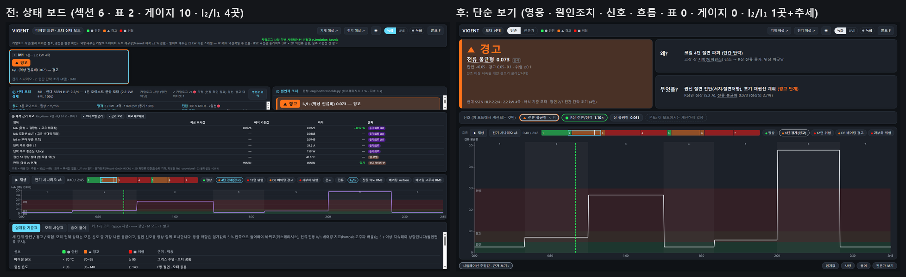

# 상태 보드 단순 보기 — 3단 정보 구조 (2026-10-26)

`#/status` 의 첫 화면을 "상태 · 원인 · 조치" 세 가지만 보이게 바꿨다. 데이터·판정·엔진은 그대로이고 **화면 구성만** 바뀌었다.
기존 화면은 헤더 토글 **전문가**로 그대로 볼 수 있다(삭제 없음, 토글은 세션 안에서만 기억).

| 층 | 어디 | 무엇 |
|---|---|---|
| 1 한눈에 | 첫 화면 (`SimpleView.tsx`) | 영웅(상태 단어·원인 신호·임계 구간·지속 각주·모터·장면) / 왜? 두 줄 / 무엇을? 두 줄 / 신호 칩 / 흐름(재생 바·추세) |
| 2 펼쳐서 | 하단 칩 → 시트 | 임계값 기준표(+쉬운 설명 열) · 모터 사양표 · 용어 풀이 |
| 3 근거 | `시뮬레이션 추정값 · 근거 보기 ›` → 서랍 (`EvidenceDrawer.tsx`, 560 px) | ① 정직성 4줄 전문 ② 해석 근거 비교(시뮬값 있는 행만 기본) ③ 근거 사슬 ④ 한계 |

## 원칙 (TASK §0) 과 구현

1. **첫 화면 = 세 질문의 답만** — 섹션 4개(영웅·원인조치·신호·흐름). 표 0·게이지 0.
2. **한 숫자는 한 곳에** — I₂/I₁(전류 불균형)은 영웅 1곳 + 추세 차트. 신호 띠에서 영웅과 같은 신호는 숫자 대신 `↖ 위`(툴팁에 값).
3. **쉬운 말 먼저** — `public/content/status/labels_plain.yaml`(전문 용어 ↔ 쉬운 말 ↔ 툴팁). `역상 전류비 I₂/I₁ → 전류 불균형`, `kurtosis → 충격성(첨도)`, `히스테리시스 5 %·지속 3 s → "3초 이상 지속될 때만 경보가 올라갑니다"`(초 수는 thresholds.persistence_s 에서), `참고·임시 기준 → 임시 태그`. 원인·조치 문장(narration cause_chain)의 용어도 같은 사전으로 치환하고 원문은 `<abbr title>` 툴팁.
4. **계산되지 않는 값은 보이지 않게** — 전기 모드(온도 전부 25 °C 고정)는 온도 칩 대신 "온도: 이 모드에서는 계산하지 않음" 한 줄. 비교표에서 시뮬값 `—` 행은 "표시 안 함 n행 ▾"로 접고 사유는 툴팁.
5. **글자 크기** — 영웅 46 px·원인 22 px·원인·조치 18 px·본문 15 px·표 13 px (`--sv` 배율: 발표 1.25, 1366×768 0.82).
6. **색은 상태 셋만** — 초록·주황·빨강(config colors) + ●▲■. 단순 보기에서는 강조색(accent) 사용 없음(헤더 토글·LIVE 토글도 전경/배경색). 출처 등급 색은 서랍 안에서만.
7. **정직성 한 줄 칩** — 하단 `시뮬레이션 추정값 · 근거 보기 ›`, 서랍에 4줄 전문.
8. **옛 라벨 제거** — "1톤", "권상 7 m/min" 0건(`grep -rn "1톤\|권상 7\|hoist_ton\|hoist_speed" src`). 모터는 `현대 SSEN HLP-2.2/4 · 2.2 kW 4극 · 해석 기준 모터`(M1.yaml name·spec 에서).

## 와이어프레임 (1920×1080)

```
┌───────────────────────────────────────────────────────────────────────┐
│ VIGENT  모터 상태  [단순|전문가]  ●안전 ▲경고 ■위험   기계 해설 전기 해설 ☀ 녹화/LIVE 발표 F │
├───────────────────────────────┬───────────────────────────────────────┤
│  ▲  경 고                      │ 왜?     코일 4턴 절연 파괴 (턴간 단락)      │
│  전류 불균형 0.073 [임시]        │         고장 상 저항(임피던스) 감소 → …    │
│  안전 <0.05 · 경고 0.05~0.1 ·  ├───────────────────────────────────────┤
│  위험 ≥0.1 (3초 이상 지속 시)   │ 무엇을?  권선 절연 진단, 조기 재권선 계획 (경고 단계) │
│  현대 SSEN HLP-2.2/4 · 2.2 kW … │         R상만 정상 (5.2 A), 전류 불균형 0.073 … │
├───────────────────────────────┴───────────────────────────────────────┤
│ 신호 (이 모드에서 계산되는 것만)  ▲전류 불균형 ↖위  ●R상 전류/정격 1.10×  상 불평형 0.061  [온도: 이 모드 미계산] │
├───────────────────────────────────────────────────────────────────────┤
│ 흐름 ▶재생 전기 시나리오⇄ 0:40/2:45 [1][2][3][4][5][6][7] ●정상 ●4턴 ●12턴 ●베어링 ●과부하 │
│ ──────────────── 전류 불균형 추세 (임계 띠 연하게, 선 하나) ────────────────── │
├───────────────────────────────────────────────────────────────────────┤
│ 시뮬레이션 추정값 · 근거 보기 ›                 임계값 · 사양 · 용어 · 전문가 보기 │
└───────────────────────────────────────────────────────────────────────┘
```

## 전/후 스크린샷 (`docs/dashboard_simple_view/img/`)

| 전 (기존 보드) | 후 (단순 보기) |
|---|---|
|  |  |



- 1366×768: `before_1366_dark.png` / `after_1366_dark.png` · 라이트: `before_1920_light.png` / `after_1920_light.png`
- 12턴 위험 `after_1920_12turn_danger.png` · 정상 `after_1920_healthy.png` · 기계(베어링, 27.5 s) `after_1920_mech_bearing.png`
- 근거 서랍 `after_1920_drawer.png` · 발표 모드(F) `after_1920_present.png` · 임계값 시트 `after_1920_thresholds.png` · 전문가 보기 `after_1920_expert.png`
- 스크립트: `dashboard/tools/simple_view_shots.mjs before|after <out>` (Playwright + 설치된 Edge, PowerShell 에서)

## 데이터 보강 (export 필드 추가만, §3)

`dashboard/tools/export_status_data.py` 가 `<id>_<mode>.json` 에 케이스별 엔진 값을 붙인다 — 값 계산은 `engine.CurrentModel` 그대로(`lut_point`·`evaluate_case`·`short_loop`·`loop_loss_W`).

| 필드 | 뜻 | 전기 모드 4턴 값 | 서랍 비교표 |
|---|---|---|---|
| `i2i1_fault` | LUT 결함분 r (고유 비대칭 제외) | 0.048967 (기준 0.0488, +0.31 %) | 채워짐 |
| `i2_over_in` | I₂/I_n (electrical.yaml 정격) | 0.07503 (기준 0.0749, +0.22 %) | 채워짐 |
| `i_f_A` | 단락 루프 전류 | 34.381 A (기준 34.35, +0.10 %) | 채워짐 |
| `p_loop_total_W` | 단락 루프 총손실 | 158.1 W (+0.36 %) | 채워짐 |
| `winding_dT_C` | 권선 온도 − 첫 샘플 | 전기 모드 null (열 모델 미실행) · 기계 모드 최대 33.7 °C | `—` 1행 접힘, 사유 툴팁 |
| `extras_note` | 각 필드의 출처·null 사유 | — | 셀 툴팁 |

export 전/후 diff(HEAD 스크립트를 임시 폴더로 실행해 비교): **기존 필드 변화 0**, 추가 필드 6개뿐(`docs/dashboard_simple_view/export_diff.json`: `changed_existing: []`).

## 검수 결과 (§5)

| 기준 | 결과 |
|---|---|
| 첫 화면 표 0·게이지 0·섹션 4 | ✓ (영웅·원인조치·신호·흐름; 헤더와 하단 칩 줄은 내비게이션) |
| I₂/I₁ 숫자 위치 | 영웅 1곳 + 추세 차트 (신호 띠는 `↖ 위`) ✓ |
| 5초 테스트 | 스크린샷에서 상태(경고)·원인(코일 4턴 절연 파괴)·조치(권선 절연 진단…) 눈금 없이 읽힘 ✓ |
| 첫 화면 본문 전문 용어 | 사전 치환(툴팁 원문). 남는 것: 조치 문장의 "서지·절연저항"(현장 점검 항목, narration 원문) |
| 옛 라벨 | grep 0건 ✓ (M1.yaml `name` 의 "1톤 호이스트" 는 config 라 손대지 않고, 화면은 ` — ` 앞부분만 표시) |
| 전기 모드 25 °C 온도 게이지 | 없음 ✓ ("온도: 이 모드에서는 계산하지 않음") |
| 서랍 비교표 `—` 기본 숨김·시뮬값 행 ≥ 5 | ✓ 값 행 5 + 판정 1, 숨김 1(권선 ΔT) |
| 해상도·테마 스크린샷 | 1920×1080 / 1366×768 · 다크 / 라이트 · 전후 비교 1장 ✓ |
| `npm run build`(tsc) | ✓ · 오프라인(정적 dist, CDN 없음) ✓ |
| 단축키·녹화·LIVE | Space·←→·M·F·K·Esc 유지. 단순 보기에서 숫자 키 1~5 = 장면 칩(§4), 전문가 보기에서는 모터 선택(기존). 헤더 녹화/LIVE 토글 그대로 ✓ |
| 판정·숫자 변화 0 | export diff 추가 필드만 ✓ · 테스트 151 passed·1 skipped |

## 한계

- 상태 보드 데이터의 정직성 문구("열회로 계수는 22 kW 기준 스케일 — M1에서 낙관적일 수 있음")는 서랍 ①에만 보인다. 해설 화면(#/electrical·#/mechanical)의 22 kW 녹화 영상은 이 작업 범위 밖(링크만 유지).
- 전기 모드 `winding_dT_C` 는 열 모델을 돌리지 않아 null — 통합·기계 모드에서만 값이 있다.
- "상 불평형" 칩은 상별 전류 비율의 편차(최대 |r−평균|/평균)를 표시만 하고 판정에는 쓰지 않는다(새 지표 계산 아님 — 보조 표시).
- 네이티브 title 툴팁은 스크린샷에 찍히지 않는다. 캡처 때는 DOM 오버레이로 표시한다(미디어 팩 도구).
