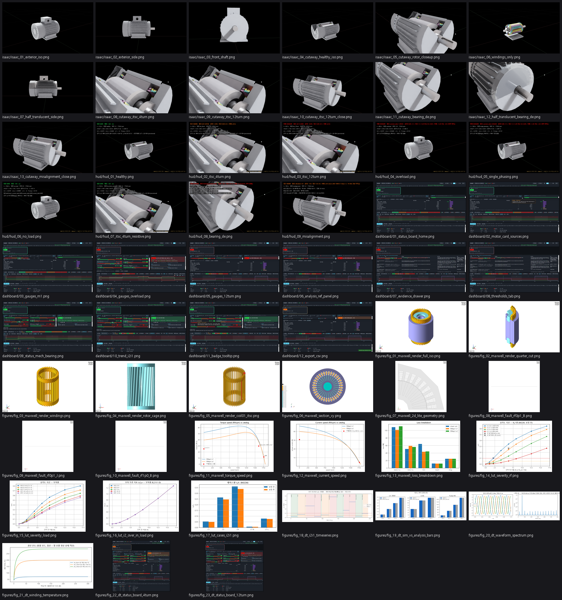

# 보고용 미디어 팩 — 2026-10-26

M1 (HLP-2.2/4) 디지털 트윈 — Isaac Sim 4.5 장면·HUD·대시보드·해석 그림. 커밋 DT `75bd475` · Maxwell `3c4e22e` · 시드 없음(결정적) · 배속 1×.
모든 숫자는 엔진 출력(state.csv)·검증 산출물·LUT 값이며 연출용 숫자는 없다. 파일명은 ASCII, 설명은 이 표의 캡션. 규격·재현·수동 캡처 체크리스트는 `README.md`.

  (57 장 썸네일)

## Isaac Sim 사진 (13 장) — `isaac/`

| 파일 | 해상도 | 모드·t(s)·뷰·카메라 | 캡션 | KB |
|---|---|---|---|---|
| [isaac_01_exterior_iso.png](isaac/isaac_01_exterior_iso.png) | 2560x1440 | electrical · 6.0 · full · iso | 모터 외형 등각 — 정상 운전 (M1 HLP-2.2/4, 100L 프레임) | 465 |
| [isaac_02_exterior_side.png](isaac/isaac_02_exterior_side.png) | 1920x1080 | electrical · 8.0 · full · side | 모터 외형 측면 (−Y 방향) | 215 |
| [isaac_03_front_shaft.png](isaac/isaac_03_front_shaft.png) | 1920x1080 | electrical · 10.0 · full · front_shaft | 축단 정면 (+X 에서 본 DE 축단·엔드실드) | 242 |
| [isaac_04_cutaway_healthy_iso.png](isaac/isaac_04_cutaway_healthy_iso.png) | 2560x1440 | electrical · 14.0 · cutaway · iso | 절단 뷰 등각 — 정상 (고정자 권선·로터·DE/NDE 베어링) | 404 |
| [isaac_05_cutaway_rotor_closeup.png](isaac/isaac_05_cutaway_rotor_closeup.png) | 1920x1080 | electrical · 16.0 · cutaway · rotor_closeup | 절단 뷰 상부 근접 — 코일 엔드·로터 코어·엔드링 (DE 쪽) | 733 |
| [isaac_06_windings_only.png](isaac/isaac_06_windings_only.png) | 1920x1080 | electrical · 18.0 · windings_only · iso | 권선만 — 36슬롯 2층 권선 코일 배치 (Coil_01 단락 루프 포함) | 235 |
| [isaac_07_half_translucent_side.png](isaac/isaac_07_half_translucent_side.png) | 1920x1080 | electrical · 19.5 · half_translucent · side | 반절 반투명 뷰 측면 — 정상 (한쪽 반이 비침, 절단 없음) | 217 |
| [isaac_08_cutaway_itsc_4turn.png](isaac/isaac_08_cutaway_itsc_4turn.png) | 2560x1440 | electrical · 36.0 · cutaway · fault_focus | 턴간 단락 4턴 — Coil_01 단락 루프 발광, I₂/I₁ 경계(경고) | 1403 |
| [isaac_09_cutaway_itsc_12turn.png](isaac/isaac_09_cutaway_itsc_12turn.png) | 1920x1080 | electrical · 62.0 · cutaway · fault_focus | 턴간 단락 12턴 — 위험 (단락 루프 발광 강함) | 890 |
| [isaac_10_cutaway_itsc_12turn_close.png](isaac/isaac_10_cutaway_itsc_12turn_close.png) | 1920x1080 | electrical · 64.0 · cutaway · close | 턴간 단락 12턴 근접 — 전류 경로·권선 발열 색 | 516 |
| [isaac_11_cutaway_bearing_de.png](isaac/isaac_11_cutaway_bearing_de.png) | 1920x1080 | mechanical · 52.0 · cutaway · bearing_de | DE 베어링 열화 — 절단 뷰 베어링 근접 (온도 색) | 832 |
| [isaac_12_half_translucent_bearing_de.png](isaac/isaac_12_half_translucent_bearing_de.png) | 1920x1080 | mechanical · 55.0 · half_translucent · bearing_de | DE 베어링 열화 — 반절 반투명 뷰 (DE 엔드실드·하우징 너머 내부가 비침) | 874 |
| [isaac_13_cutaway_misalignment_close.png](isaac/isaac_13_cutaway_misalignment_close.png) | 1920x1080 | mechanical · 78.0 · cutaway · close | 축 정렬 불량 — 근접 (양쪽 베어링·축 온도) | 508 |

## HUD 합성 사진 (9 장) — `hud/` · state.csv 대조 9/9 PASS

| 파일 | t(s) | 판정 | I₂/I₁ · I R/S/T [A] · 권선 °C | 캡션 | KB |
|---|---|---|---|---|---|
| [hud_01_healthy.png](hud/hud_01_healthy.png) | 12.02 | SAFE (- 0.0) | 0.027 · 4.821/4.632/4.632 · 25.0 | 정상 (3상 균형, 고유 비대칭만) | 292 |
| [hud_02_itsc_4turn.png](hud/hud_02_itsc_4turn.png) | 36.48 | WARN (i2i1 0.0726) | 0.07262 · 5.215/4.857/4.607 · 25.0 | 턴간 단락 4턴 — I₂/I₁ 경계(경고) | 908 |
| [hud_03_itsc_12turn.png](hud/hud_03_itsc_12turn.png) | 62.49 | DANGER (i2i1 0.2696) | 0.26958 · 7.395/6.016/4.692 · 25.0 | 턴간 단락 12턴 — 위험 | 917 |
| [hud_04_overload.png](hud/hud_04_overload.png) | 88.01 | DANGER (current_ratio 1.39535) | 0.027 · 6.557/6.301/6.301 · 25.0 | 과부하 운전 — 전류/정격 상한 | 334 |
| [hud_05_single_phasing.png](hud/hud_05_single_phasing.png) | 137.96 | DANGER (current_ratio 0.04228) | 0.47917 · 0.170/6.044/6.044 · 25.0 | 결상 (R상 끊김) — 결상 의심 위험 | 297 |
| [hud_06_no_load.png](hud/hud_06_no_load.png) | 157.97 | SAFE (- 0.0) | 0.027 · 1.603/1.540/1.540 · 25.0 | 무부하 저전류 — 경부하(참고) 규칙 (세 상 함께 낮고 균형) | 329 |
| [hud_07_itsc_4turn_resistive.png](hud/hud_07_itsc_4turn_resistive.png) | 218.0 | SAFE (- 0.0) | 0.03244 · 4.871/4.661/4.628 · 25.0 | 저항성 4턴 (R_f 1.0 Ω) — 전류로 탐지 불가 | 895 |
| [hud_08_bearing_de.png](hud/hud_08_bearing_de.png) | 52.49 | DANGER (bearing_kurtosis 50.0) | 0.027 · 4.821/4.632/4.632 · 46.73 | DE 베어링 열화 — 진동·베어링 온도 | 821 |
| [hud_09_misalignment.png](hud/hud_09_misalignment.png) | 78.51 | WARN (vibration 3.6) | 0.027 · 4.821/4.632/4.632 · 47.18 | 축 정렬 불량 — 양쪽 베어링·축 온도 | 562 |

## 대시보드 사진 (12 장) — `dashboard/`

| 파일 | 해상도 | URL | 캡션 | 22 kW 문구 |
|---|---|---|---|---|
| [01_status_board_home.png](dashboard/01_status_board_home.png) | 1920x1080 | `/#/status?m=M1&t=40` | 상태 보드 첫 화면 — M1 카드·시나리오 칩·정직성 4줄 (전기 모드 40 s, 4턴 경고 구간) | 보임 |
| [02_motor_card_sources.png](dashboard/02_motor_card_sources.png) | 1920x1080 | `/#/status?m=M1&t=40` | 모터 상세 출처 아이콘 — 결선(Y) 항목의 출처 툴팁을 오버레이로 표시 (현장 확인 필요 표시) — 툴팁 원문: “가정 (현장 확인 필요) · 380 V 전용형 내부 결선은 카탈로그에 없음. RMxprt·LUT 모델(상전압 219.4 V)과 일치시킴 · verify_on_site” | 보임 |
| [03_gauges_m1.png](dashboard/03_gauges_m1.png) | 1920x1080 | `/#/status?m=M1&t=40` | 게이지 — 진동(ISO 10816-1 Class I)·전류/정격·I₂/I₁·온도, 4턴 경고 시각 40 s | 보임 |
| [04_gauges_overload.png](dashboard/04_gauges_overload.png) | 1920x1080 | `/#/status?m=M1&t=40` | (대체) 상태 보드 전기 모드 과부하 장면(85 s) 게이지 — 전류/정격 상한 위험 | 보임 |
| [05_gauges_12turn.png](dashboard/05_gauges_12turn.png) | 1920x1080 | `/#/status?m=M1&t=40` | (대체) 상태 보드 전기 모드 12턴 위험(60 s) 게이지 — I₂/I₁ 위험, R상 과전류 | 보임 |
| [06_analysis_ref_panel.png](dashboard/06_analysis_ref_panel.png) | 1920x1080 | `/#/status?m=M1&t=40` | ④ 해석 근거 비교 — 시뮬 | 해석 기준값 | 차이 % | 출처 배지 (12턴, 60 s) | 보임 |
| [07_evidence_drawer.png](dashboard/07_evidence_drawer.png) | 1920x1080 | `/#/status?m=M1&t=40` | '근거 보기' 서랍 — 표시량 → 엔진 → 파일(sha) → 해석 단계 → 등급 + 한계 | 보임 |
| [08_thresholds_tab.png](dashboard/08_thresholds_tab.png) | 1920x1080 | `/#/status?m=M1&t=40` | 임계값 기준표 탭 — 신호별 안전/경고/위험 경계와 근거(source·status) | 보임 |
| [09_status_mech_bearing.png](dashboard/09_status_mech_bearing.png) | 1920x1080 | `/#/status?m=M1&t=40` | (대체) 상태 보드 기계 모드 DE 베어링 경고 장면(27.5 s) — 베어링 온도·진동 게이지 | 보임 |
| [10_trend_i2i1.png](dashboard/10_trend_i2i1.png) | 1920x1080 | `/#/status?m=M1&t=40` | (대체) 상태 보드 추세 차트 — I₂/I₁ 시계열과 임계선 (전기 모드 40 s) | 보임 |
| [11_badge_tooltip.png](dashboard/11_badge_tooltip.png) | 1920x1080 | `/#/status?m=M1&t=40` | 게이지 '참고 · 임시 기준' 배지 툴팁 — 실측 기준선 미확보(provisional) 문장을 오버레이로 표시 — 툴팁 원문: “실측 기준선 미확보 (출처 catalog, 상태 provisional) — 실측 모드에서는 판정에 반영되지 않음(advisory). 시뮬레이션 시나리오: 임시 기준으로 종합 판정에 포함” | 보임 |
| [12_export_csv.png](dashboard/12_export_csv.png) | 1920x1080 | `/#/status?m=M1&t=40` | '비교 내보내기' 직후 — 다운로드 파일 export_20261026_152811.csv (V2 형식 CSV, 4턴 40 s) | 보임 |

제외(22 kW 자산·문구): 04_elec_panel_4turn / 05_elec_panel_12turn (#/electrical) — 해설 화면은 이전 22 kW 녹화 영상(public/media/integrated_autoplay.mp4)을 재생 — 22 kW 자산 사용 금지. 상태 보드 전기 모드 장면(04·05)으로 대체; 09_narration_mech_bearing / 10_narration_elec_itsc (#/mechanical, #/electrical) — 같은 이유. 상태 보드 기계 모드(09)·추세 차트(10)로 대체

## 영상·GIF (10 편) — `video/`

| 파일 | 길이 s | 장면 시각 | 캡션 | MB |
|---|---|---|---|---|
| [01_exterior_orbit.mp4](video/01_exterior_orbit.mp4) | 20.0 | 2~22 s | 외형 360° 궤도 1회전 (전기 시나리오 정상 구간, HUD 포함) | 2.7 |
| [02_cutaway_orbit.mp4](video/02_cutaway_orbit.mp4) | 20.0 | 26~46 s | 절단 뷰 360° 궤도 — 20~45 s 는 4턴 장면이라 Coil_01 단락 루프가 발광한다 | 2.8 |
| [03_electrical_fault.mp4](video/03_electrical_fault.mp4) | 76.0 | 0~76 s | 전기 시나리오 0~76 s: 정상(0~20)·4턴 경고(20~45)·12턴 위험(45~75), 카메라 외형→절단→fault_focus→근접 | 11.0 |
| [04_half_translucent_orbit.mp4](video/04_half_translucent_orbit.mp4) | 20.0 | 50~70 s | 반절 반투명 뷰 360° 궤도 — 45 s 이후 12턴 장면 | 3.6 |
| [05_mechanical_bearing.mp4](video/05_mechanical_bearing.mp4) | 75.0 | 10~85 s | 기계 시나리오 10~85 s: 정상(~25)·DE 베어링 열화(25~60)·축 정렬 불량(60~85) | 8.5 |
| [06_integrated_full.mp4](video/06_integrated_full.mp4) | 166.0 | 0~166 s | 통합 시나리오 전체 0~166 s: 정상·베어링·4턴·12턴·결론 | 26.1 |
| [gif_01_orbit.gif](video/gif_01_orbit.gif) |  | 01_exterior_orbit.mp4 | 01_exterior_orbit 의 0~10 s (12 fps) | 3.43 |
| [gif_02_itsc_glow.gif](video/gif_02_itsc_glow.gif) |  | 03_electrical_fault.mp4 | 03_electrical_fault 의 18~46 s (12 fps) | 5.85 |
| [07_dashboard_walkthrough.mp4](video/07_dashboard_walkthrough.mp4) | 54.2 |  | 대시보드 워크스루 — 첫 화면(15 s) → 4턴 칩 → 게이지 → 해석 근거 비교 → 근거 보기 → 12턴 칩 → 맨 위 (Edge 창 화면 녹화, 1920×1080) | 1.4 |
| [08_side_by_side.mp4](video/08_side_by_side.mp4) |  |  | Isaac 전기 시나리오 녹화(왼쪽, 장면 0~60 s)와 대시보드 상태 보드 재생(오른쪽, 같은 시각) 나란히 — 동기는 재생 클릭 벽시계 기준 ±0.5 s | 3.2 |

## 해석·검증 그림 (23 장) — `figures/`

| 파일 | 원본 | 해상도(원본 그대로) | 캡션 |
|---|---|---|---|
| [fig_01_maxwell_render_full_iso.png](figures/fig_01_maxwell_render_full_iso.png) | hoist-motor-maxwell: `docs/maxwell/img/render_01_full_iso.png` | 1920x1080 | Maxwell 3D 모델 전체 등각 렌더 |
| [fig_02_maxwell_render_quarter_cut.png](figures/fig_02_maxwell_render_quarter_cut.png) | hoist-motor-maxwell: `docs/maxwell/img/render_02_quarter_cut.png` | 1920x1080 | Maxwell 3D 1/4 절단 렌더 |
| [fig_03_maxwell_render_windings.png](figures/fig_03_maxwell_render_windings.png) | hoist-motor-maxwell: `docs/maxwell/img/render_03_windings.png` | 1920x1080 | Maxwell 고정자 권선 렌더 |
| [fig_04_maxwell_render_rotor_cage.png](figures/fig_04_maxwell_render_rotor_cage.png) | hoist-motor-maxwell: `docs/maxwell/img/render_04_rotor_cage.png` | 1920x1080 | Maxwell 로터 케이지 렌더 |
| [fig_05_maxwell_render_coil01_itsc.png](figures/fig_05_maxwell_render_coil01_itsc.png) | hoist-motor-maxwell: `docs/maxwell/img/render_05_coil01_itsc.png` | 1920x1080 | Maxwell Coil_01 턴간 단락 분할 렌더 |
| [fig_06_maxwell_section_xy.png](figures/fig_06_maxwell_section_xy.png) | hoist-motor-maxwell: `docs/maxwell/img/m2_full_section_xy.png` | 2560x1440 | Maxwell 2D 단면 (XY) |
| [fig_07_maxwell_2d_lite_geometry.png](figures/fig_07_maxwell_2d_lite_geometry.png) | hoist-motor-maxwell: `docs/maxwell/img/s1_lite_q_geometry.png` | 1400x1400 | 2D-eddy-lite 해석 형상 (1/4) |
| [fig_08_maxwell_fault_rf0p1_B.png](figures/fig_08_maxwell_fault_rf0p1_B.png) | hoist-motor-maxwell: `docs/maxwell/img/s3_fault_rf0p1_B.png` | 1400x1400 | 턴간 단락 R_f 0.1 Ω 자속밀도 B (2D) |
| [fig_09_maxwell_fault_rf0p1_J.png](figures/fig_09_maxwell_fault_rf0p1_J.png) | hoist-motor-maxwell: `docs/maxwell/img/s3_fault_rf0p1_J.png` | 1400x1400 | 턴간 단락 R_f 0.1 Ω 전류밀도 J (2D) |
| [fig_10_maxwell_fault_rf1p0_B.png](figures/fig_10_maxwell_fault_rf1p0_B.png) | hoist-motor-maxwell: `docs/maxwell/img/s3_fault_rf1p0_B.png` | 1400x1400 | 턴간 단락 R_f 1.0 Ω 자속밀도 B (2D) |
| [fig_11_maxwell_torque_speed.png](figures/fig_11_maxwell_torque_speed.png) | hoist-motor-maxwell: `docs/maxwell/img/m6_torque_speed.png` | 941x611 | RMxprt 토크–속도 곡선 |
| [fig_12_maxwell_current_speed.png](figures/fig_12_maxwell_current_speed.png) | hoist-motor-maxwell: `docs/maxwell/img/m6_current_speed.png` | 890x611 | RMxprt 전류–속도 곡선 |
| [fig_13_maxwell_loss_breakdown.png](figures/fig_13_maxwell_loss_breakdown.png) | hoist-motor-maxwell: `docs/maxwell/img/m6_loss_breakdown.png` | 899x585 | RMxprt 손실 분해 |
| [fig_14_lut_severity_rf.png](figures/fig_14_lut_severity_rf.png) | hoist-motor-maxwell: `docs/maxwell/img/e3_severity_rf.png` | 909x614 | LUT: 단락 턴수·R_f 별 I₂/I₁ (결함분) |
| [fig_15_lut_severity_load.png](figures/fig_15_lut_severity_load.png) | hoist-motor-maxwell: `docs/maxwell/img/e3_severity_load.png` | 909x613 | LUT: 부하별 I₂/I₁ |
| [fig_16_lut_i2_over_in_load.png](figures/fig_16_lut_i2_over_in_load.png) | hoist-motor-maxwell: `docs/maxwell/img/e3_i2_over_in_load.png` | 909x613 | LUT: 부하별 I₂/I_n |
| [fig_17_lut_cases_i2i1.png](figures/fig_17_lut_cases_i2i1.png) | hoist-motor-maxwell: `docs/maxwell/img/e3_cases_i2i1.png` | 903x536 | 시나리오 케이스별 I₂/I₁ (LUT) |
| [fig_18_dt_i2i1_timeseries.png](figures/fig_18_dt_i2i1_timeseries.png) | motor-predictive-maintenance: `docs/verification/img/i2i1_timeseries.png` | 1560x546 | DT 검증: I₂/I₁ 시계열 (시뮬 vs 해석 기준) |
| [fig_19_dt_sim_vs_analysis_bars.png](figures/fig_19_dt_sim_vs_analysis_bars.png) | motor-predictive-maintenance: `docs/verification/img/sim_vs_analysis_bars.png` | 1560x494 | DT 검증: 시뮬 vs 해석 차이 막대 |
| [fig_20_dt_waveform_spectrum.png](figures/fig_20_dt_waveform_spectrum.png) | motor-predictive-maintenance: `docs/verification/img/waveform_spectrum.png` | 1560x494 | DT 검증: 상전류 파형·스펙트럼 |
| [fig_21_dt_winding_temperature.png](figures/fig_21_dt_winding_temperature.png) | motor-predictive-maintenance: `docs/verification/img/winding_temperature.png` | 1040x520 | DT 검증: 권선 온도 (열회로) |
| [fig_22_dt_status_board_4turn.png](figures/fig_22_dt_status_board_4turn.png) | motor-predictive-maintenance: `docs/verification/img/status_board_4turn_warn.png` | 1600x1400 | 검증 당시 상태 보드 4턴 경고 캡처 |
| [fig_23_dt_status_board_12turn.png](figures/fig_23_dt_status_board_12turn.png) | motor-predictive-maintenance: `docs/verification/img/status_board_12turn_danger.png` | 1600x1400 | 검증 당시 상태 보드 12턴 위험 캡처 |

## 못 찍은 것

- 없음
