# 모터 결함 애니메이션 해설 — 장면별 설명과 발표 멘트

크레인 권상 모터(22 kW 6극, 도면 JW-01-HTO-00)의 결함을 Isaac Sim에서 시각화한 애니메이션 세 편을
장면 단위로 풀어 쓴 자료다. 발표자가 영상을 틀면서 그대로 읽어도 되고, 심사위원이 영상 없이 읽어도
무엇이 보이고 왜 그런지 알 수 있게 썼다.

영상은 프로젝트 폴더(`크레인 퀀선 모터 모델링`) 안의 `모터결함_애니메이션` 폴더에 있다(전체 시나리오 +
장면별 클립, 원본은 `dashboard/public/media/`). 같은 내용을 동기 차트와 함께 보려면 대시보드
`dashboard/run_dashboard_mechanical.bat` / `run_dashboard_electrical.bat` 을 연다.

> **먼저 말해 둘 것.** 화면의 모든 숫자는 시뮬레이션 기반 추정값이다. 온도는 부품 9개를 각각 한 덩어리로
> 본 열회로 모델, 전류는 해석식 3상 모델이며, 측정값도 전자계 해석(FEM) 결과도 아니다.
> 화면 1초는 열 시뮬레이션에서 60~180초다(장면마다 다르고 아래에 적었다). 실제 모터는 이렇게 빨리
> 뜨거워지지 않는다 — 발표 시간 안에 보여주기 위한 압축이다.

---

## 1. 색을 읽는 법

### 기계적 결함 영상 — 부품의 온도

부품이 뜨거워질수록 원래 재질 색 → 주황 → 붉은 주황 → 빨강 발광(0.8 Hz 로 깜빡임)으로 변한다.
**부품마다 허용 온도가 다르므로 같은 온도라도 색이 다르다.** 같은 80 °C 라도 베어링에는 위험 신호,
로터에는 평범한 온도다. 값은 "이 온도까지"를 뜻한다.

| 부품 | 정상 (원래 재질) | 주의 (주황) | 경고 (붉은 주황) | 위험 (빨강 발광) | 근거 |
|---|---|---|---|---|---|
| DE / NDE 베어링 | ~70 °C | 70~85 | 85~95 | 95 °C 초과 | 그리스 수명 |
| 고정자 권선 | ~95 °C | 95~120 | 120~140 | 140 °C 초과 | F종 절연 (허용 155 °C) |
| 로터 | ~90 °C | 90~110 | 110~130 | 130 °C 초과 | 농형 로터는 권선보다 고온이 정상 |
| 축·코어·엔드실드·하우징 | ~70 °C | 70~90 | 90~110 | 110 °C 초과 | 기본값 |

HUD 오른쪽에는 부품별 온도와 등급, 진동(ISO 20816-3 등급), 온도 색 범례가 나온다.
베어링이 경고 이상이 되면 엔드실드가 반투명해져 안쪽 베어링의 발광이 보인다.

### 전기적 결함 영상 — 케이블과 권선의 전류

세 케이블(R·S·T상)과 권선 오버레이를 따라 입자가 흐른다. 입자 속도는 전류 크기에 비례하고,
색은 **전류가 정격 대비 얼마나 많거나 적은지**를 뜻한다. 전압이 아니다.

| 상태 | 색 | 기준 (정격 대비 r) | 케이블 선전류 (정격 43.7 A) | 권선 상전류 (정격 25.2 A) |
|---|---|---|---|---|
| ▲▲ 위험 과전류 | 진한 빨강 | r > 1.25 | 54.6 A 초과 | 31.5 A 초과 |
| ▲ 주의 과전류 | 붉은 주황 | r > 1.10 | 48.1 A 초과 | 27.7 A 초과 |
| ● 정상 | 초록 | 0.85 ≤ r ≤ 1.10 | 37.1 ~ 48.1 A | 21.4 ~ 27.7 A |
| ▼ 주의 저전류 | 하늘색 | r < 0.85 | 37.1 A 미만 | 21.4 A 미만 |
| ▼▼ 위험 저전류 (결상 의심) | 진한 파랑 | r < 0.50 | 21.9 A 미만 | 12.6 A 미만 |

이 모터는 Δ(델타)결선이라 케이블에 흐르는 선전류와 권선 안의 상전류가 √3 배 다르다. 그래서 두 기준을
나눠 적었다. 권선 단락 장면에서는 권선 안에 **빨간 단락 루프**가 따로 나타나 맥동한다.

HUD 에는 상별 실효전류(RMS)와 정격 대비 %, 그리고 **I₂/I₁(역상분 비율)** 이 나온다. I₂/I₁ 은
세 줄의 전류가 서로 얼마나 균형이 깨졌는지를 나타내는 숫자로, 정상 ≈ 0.006, 4턴 단락 ≈ 0.104,
12턴 단락 ≈ 0.269 다. 권선 단락은 전류 크기보다 이 숫자에서 먼저 드러난다.

전류 파형 자체는 60 Hz 라 눈에 보이지 않으므로 입자 흐름은 60배 느리게 그렸다.

---

## 2. 기계적 결함 시나리오 (180초, 7장면)

파일: `1_기계적결함/01_기계_전체시나리오.mp4` — 장면별 클립은 `02_`~`08_`.
장면마다 **그 결함 하나만** 켠다. 결함을 쌓으면 손실 배율이 곱해져 베어링이 480 °C 같은
불가능한 값이 나오기 때문이며, 하나씩 켜야 "어느 결함이 어느 부품을 달구는가"가 드러난다.
아래 수치는 각 장면이 끝나는 시점의 값이다.

### 장면 1 — 정상 운전 (0:00–0:25, 열 배속 ×60)


**보이는 것.** 모든 부품이 원래 재질 색이다. 권선 63.6 °C, 베어링 41.2 °C, 진동 1.0 mm/s(정상).
**왜.** 정격 부하에서도 권선에는 동손, 코어에는 철손, 베어링에는 마찰열이 생기지만 냉각팬이 그만큼
내보내 온도가 일정하다.
**멘트.** "지금은 정상입니다. 모든 부품이 제 색이고, 이 상태가 이후 변화를 판단하는 기준선이 됩니다."

### 장면 2 — DE 베어링 열화 (0:25–1:00, ×120)

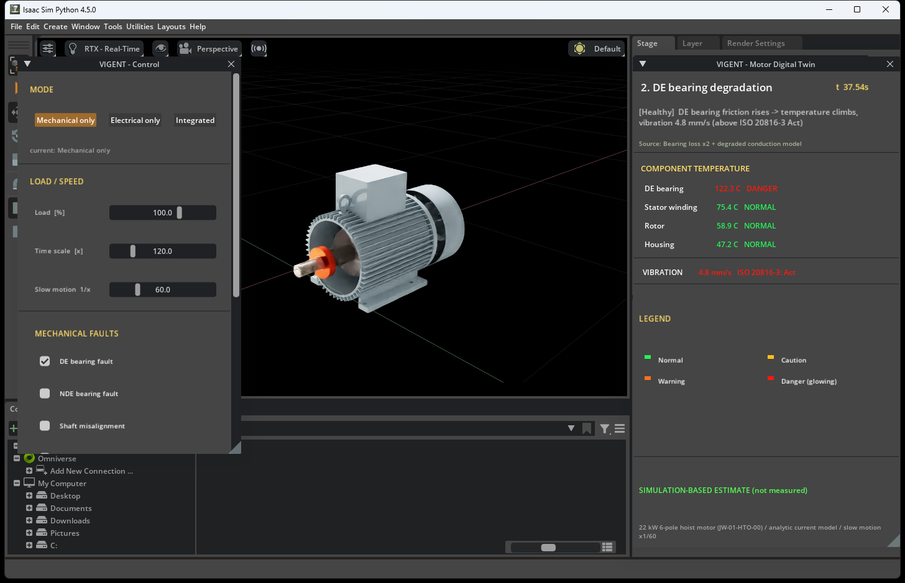

**보이는 것.** 구동측(축이 나오는 쪽) 베어링만 주황에서 빨강 발광으로 변하고, 엔드실드가 반투명해져
안쪽이 보인다. 베어링 135.7 °C(위험), 진동 4.8 mm/s(ISO 20816-3 Act — 즉시 조치 등급).
권선은 85.0 °C 로 아직 정상.
**왜.** 윤활 부족이나 마모로 마찰 손실이 커진다(시나리오에서는 5배). 열이 그 자리에서 나므로
베어링만 붉어진다.
**멘트.** "베어링 하나만 붉어졌습니다. 나머지는 아직 정상이죠. 지금이 베어링만 갈면 되는 시점입니다.
이 장면에서 VIGENT 의 경보가 먼저 울립니다 — 뒤에서 다시 말씀드리겠습니다."

### 장면 3 — 축 정렬 불량 (1:00–1:25, ×120)

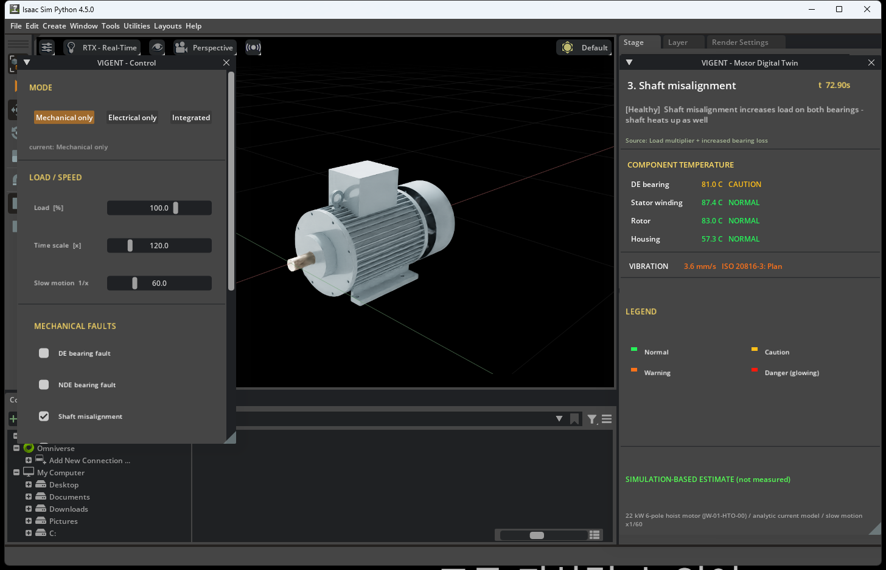

**보이는 것.** 베어링 열은 81.7 °C 로 식어 가고, 대신 축(78.0 °C)과 코어 쪽이 따뜻해진다.
진동 3.6 mm/s(Plan — 정비 계획 등급).
**왜.** 커플링 정렬이 틀어지면 축이 돌 때마다 휘어 양쪽 베어링에 하중이 걸린다. 열이 한 점이 아니라
축을 따라 퍼진다.
**멘트.** "이번엔 축 전체가 따뜻해집니다. 정렬 불량은 온도보다 진동에서 먼저 잡히는 결함입니다."

### 장면 4 — 냉각팬 고장 (1:25–1:50, ×120)

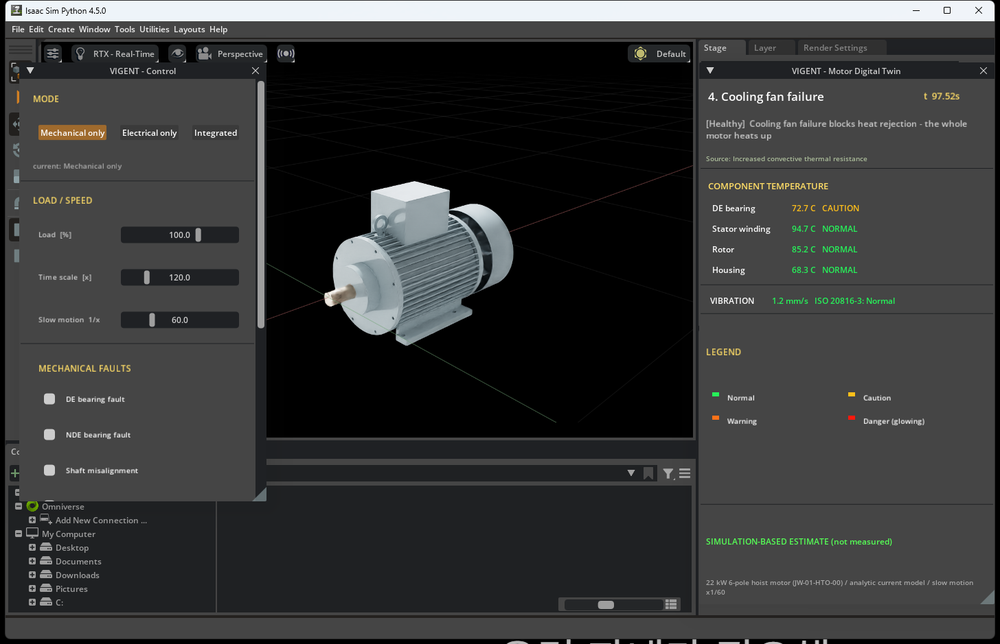

**보이는 것.** 특정 부품이 아니라 하우징(72.5 °C)부터 권선(99.4 °C, 주의)까지 전체가 고르게 올라간다.
**왜.** 팬이 서면 바람 냉각이 자연 대류로 바뀌어 열이 빠져나가는 통로가 3.2배 좁아진다.
열원은 그대로인데 출구가 막힌 것이다.
**멘트.** "어느 한 곳이 아니라 모터 전체가 주황빛이 됩니다. 이런 패턴이면 부품이 아니라 냉각을 의심합니다."

### 장면 5 — 브레이크 끌림 (1:50–2:10, ×120)

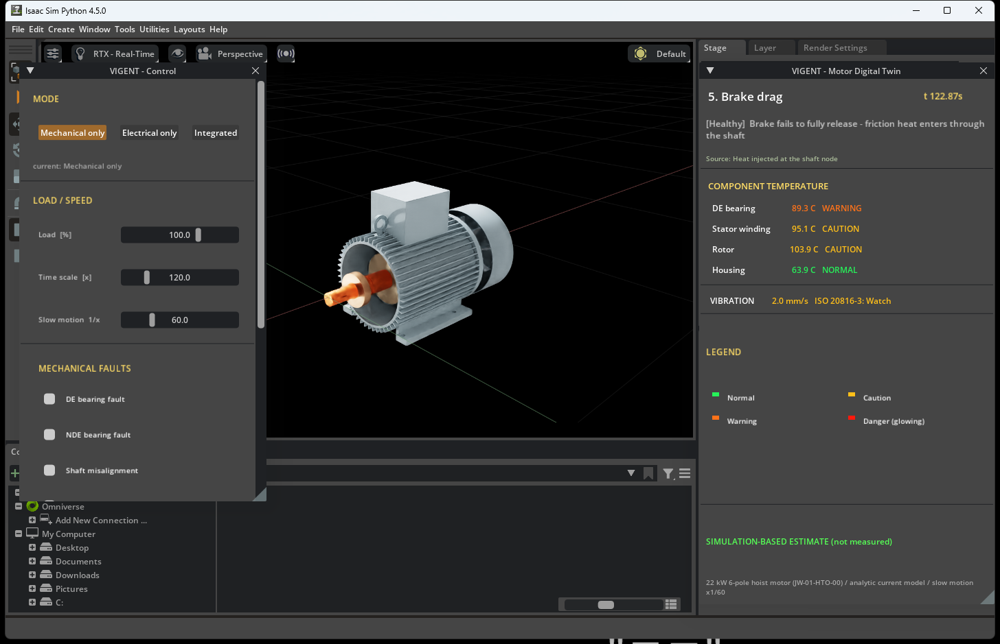

**보이는 것.** 축이 먼저 붉어지고(120.9 °C, 위험) 로터(111.0 °C)로 번진다.
**왜.** 정지용 브레이크가 완전히 떨어지지 않으면 제동면이 계속 스치며 마찰열(시나리오 900 W)이
축으로 들어온다.
**멘트.** "크레인에서 브레이크 끌림은 열 문제이기 전에 안전 문제입니다. 축이 먼저 붉어지는 것이
이 결함의 지문입니다."

### 장면 6 — 과부하 운전, 열 관점 (2:10–2:40, ×150)

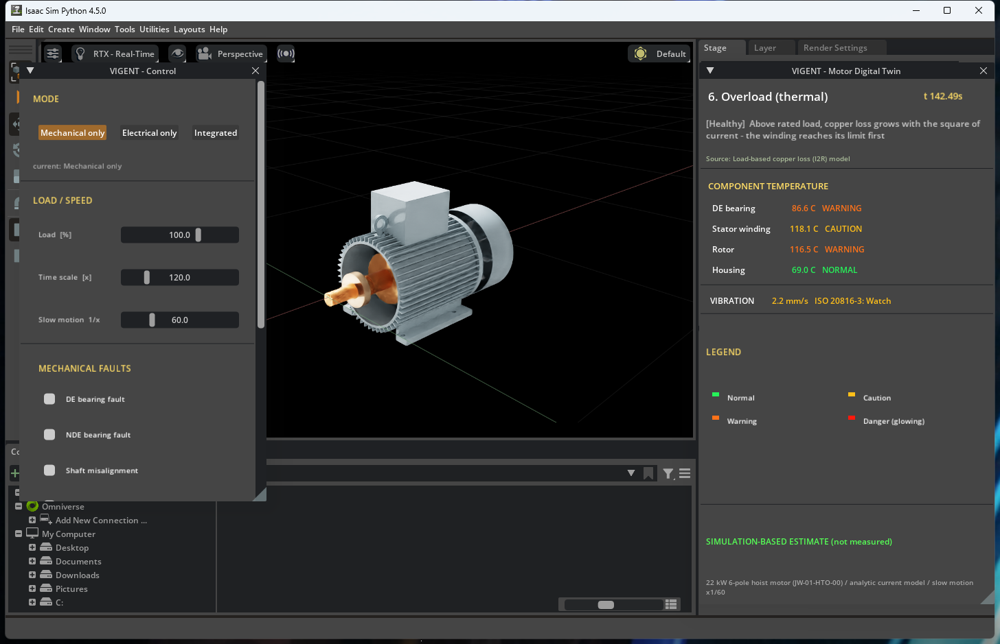

**보이는 것.** 고정자 권선이 가장 먼저 경고에 닿는다(122.4 °C). 축 102.9 °C, 로터 117.4 °C.
**왜.** 부하가 정격의 135 % 가 되면 전류가 늘고, 권선의 동손은 전류의 제곱에 비례해 커진다.
그래서 다른 부품보다 권선이 먼저 한계에 닿는다.
**멘트.** "무거운 짐을 계속 들면 권선이 먼저 뜨거워집니다. 권선 절연은 온도 한계를 넘기면 수명이
급격히 줄어듭니다."

### 장면 7 — 결함 해제 후 냉각 (2:40–3:00, ×150)

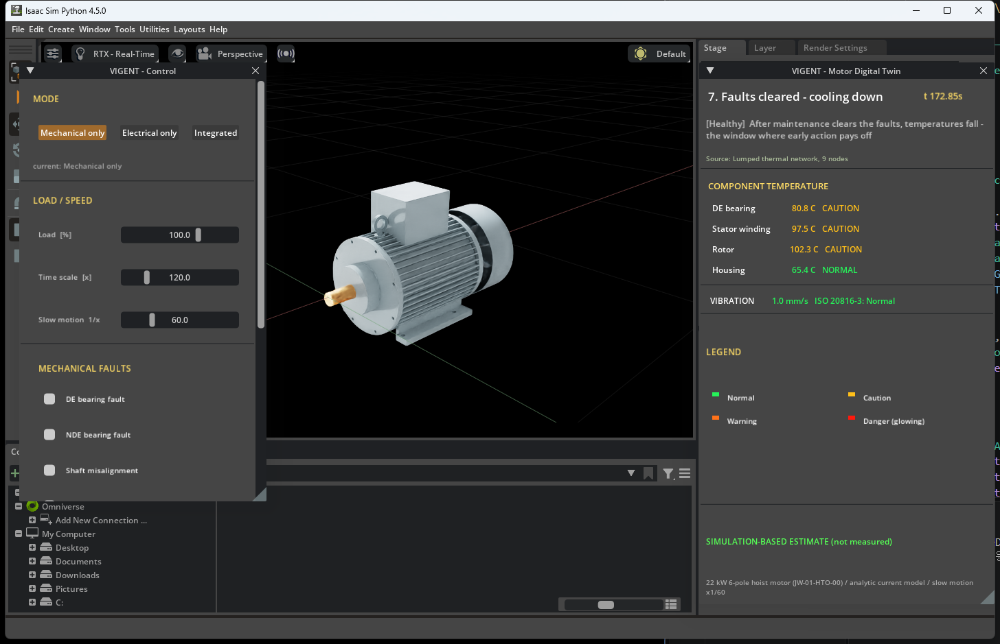

**보이는 것.** 결함을 없애자 모든 부품이 서서히 식는다. 권선 94.3 °C(정상 복귀), 베어링 77.4 °C.
**왜.** 열원이 사라지고 냉각만 남았다. 온도는 올라갈 때보다 천천히 내려온다.
**멘트.** "정비하면 돌아옵니다. 문제는 언제 아느냐입니다."

---

## 3. 전기적 결함 시나리오 (165초, 7장면)

파일: `2_전기적결함/01_전기_전체시나리오.mp4` — 장면별 클립은 `02_`~`08_`.
이 영상에서는 부품 색이 변하지 않는다(온도를 끄고 전류만 보여준다). 전류 파형은 케이스를 바꾸면
즉시 반응하므로 장면이 짧다.

### 장면 1 — 정상, 3상 균형 (0:00–0:20)

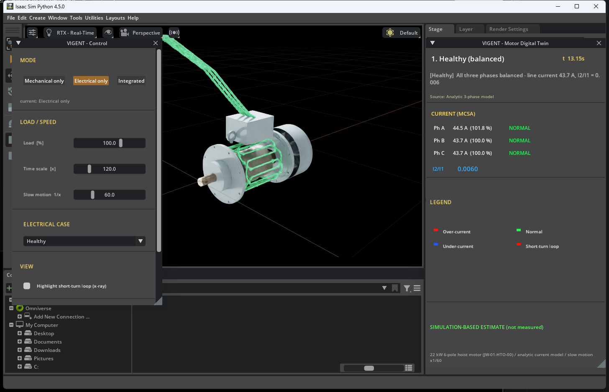

**보이는 것.** 세 케이블 모두 초록 입자가 같은 속도로 흐른다. R 44.5 / S 43.7 / T 43.7 A, I₂/I₁ 0.006.
**왜.** 세 상 전압이 고르고 권선이 온전하면 세 전류의 크기가 같고 위상이 120° 씩 벌어져 역상분이 거의 0 이다.
**멘트.** "초록이 세 줄, 균형 지표는 0.006. 이게 기준입니다."

### 장면 2 — 턴간 단락 초기, 4턴 (0:20–0:45)

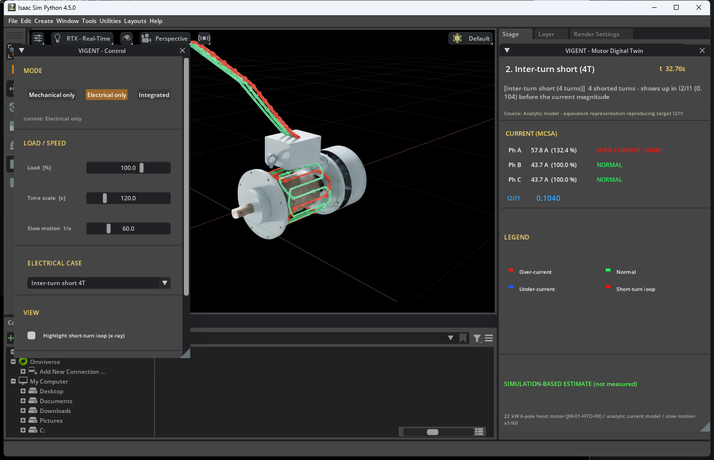

**보이는 것.** R상 케이블과 권선 오버레이가 빨강이 되고 권선 안에 빨간 단락 루프가 나타난다.
R 57.8 A(정격의 132 %, 위험 과전류), S·T 는 그대로 43.7 A. I₂/I₁ 0.104.
**왜.** 코일 4턴의 절연이 깨져 붙으면(ITSC) 그 상의 임피던스가 낮아져 전류가 늘고 균형이 깨진다.
이 장면은 목표 I₂/I₁ 0.104 를 재현한 해석식 등가 표현이다.
**멘트.** "코일 몇 턴이 붙었을 뿐인데 균형 지표가 17배 뜁니다. 크기보다 균형이 먼저 말합니다."

### 장면 3 — 턴간 단락 진행, 12턴 (0:45–1:15)

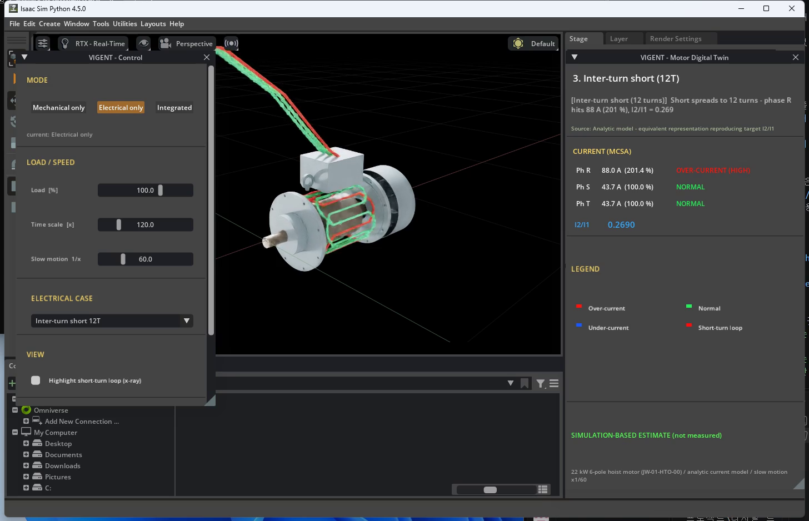

**보이는 것.** R상이 더 진한 빨강이고 입자가 빨라진다. R 88.0 A(201 %), I₂/I₁ 0.269.
**왜.** 단락 턴이 늘수록 그 상의 전류와 단락 루프의 순환 전류가 커지고, 그 열이 권선을 국부적으로 태운다.
**멘트.** "여기까지 오면 예방이 아니라 수리입니다. 우리 목표는 앞 장면에서 알리는 겁니다."

### 장면 4 — 과부하 운전 (1:15–1:35)

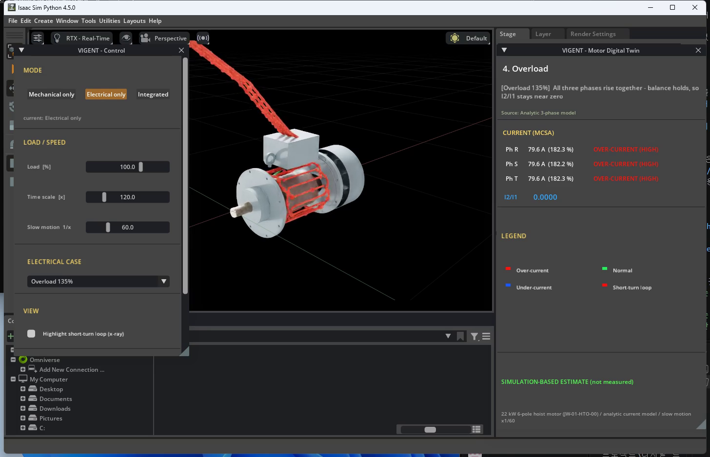

**보이는 것.** 세 케이블이 함께 빨강, 입자가 모두 빨라진다. R·S·T 모두 59.0 A(정격의 135 %). 그런데 I₂/I₁ 은 0.000.
**왜.** 무거운 짐을 들면 세 상이 똑같이 더 많은 전류를 끌어온다. 균형은 유지되므로 역상분이 없다.
크기는 문제, 균형은 정상 — 과부하와 권선 단락을 구분하는 단서다.
**멘트.** "세 줄이 같이 붉으면 과부하, 한 줄만 붉으면 단락입니다. 균형 지표가 그걸 갈라 줍니다."

### 장면 5 — 공급전압 불평형 (1:35–2:00)

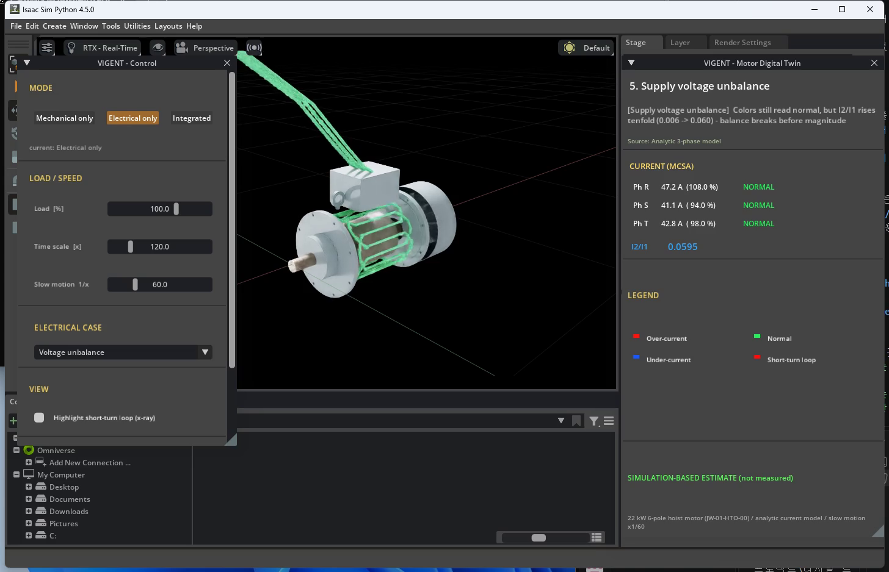

**보이는 것.** 케이블 색은 세 상 모두 초록(R 47.2 / S 41.1 / T 42.8 A, 전부 정상 범위)인데
I₂/I₁ 만 0.060 으로 정상값의 열 배가 된다.
**왜.** 공급 전압이 상마다 몇 % 만 달라도 전류 불평형은 그보다 훨씬 크게 나타난다. 크기 기준으로는
아직 정상이지만 균형은 이미 무너졌다.
**멘트.** "색은 아직 다 초록입니다. 그런데 숫자는 열 배가 올랐습니다. 색만 보면 놓치고, 숫자를 보면 잡습니다."

### 장면 6 — 결상, R상 끊김 (2:00–2:25)

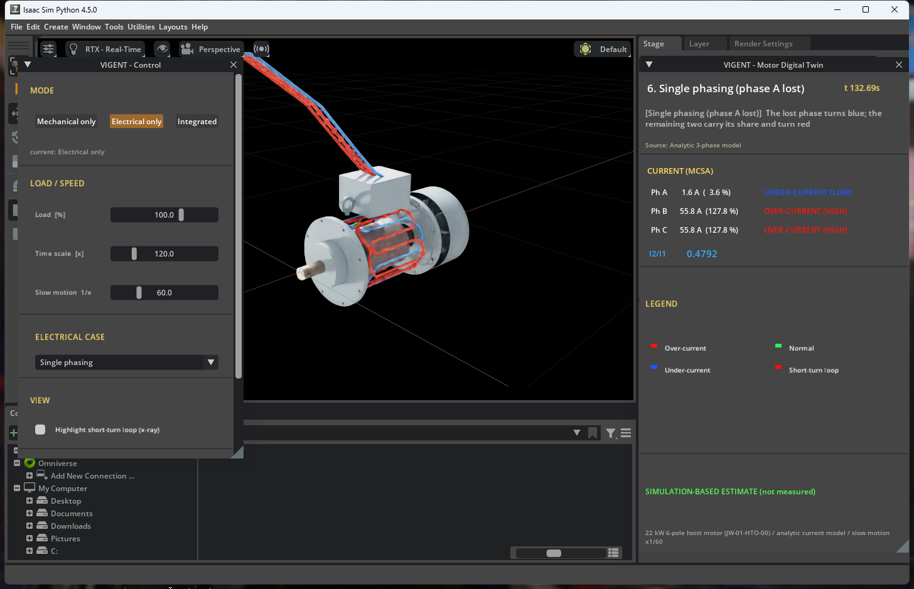

**보이는 것.** R상 케이블은 파랑(입자가 거의 멈춤, 1.6 A), S·T 는 빨강(55.8 A, 128 %). I₂/I₁ 0.479.
**왜.** 한 상이 끊기면 남은 두 상만으로 같은 힘을 내려고 하므로 그 두 상에 전류가 몰린다.
**멘트.** "한 줄이 파랗고 두 줄이 붉으면 결상입니다. 가장 급하게 세워야 하는 상태입니다."

### 장면 7 — 무부하, 저전류 (2:25–2:45)

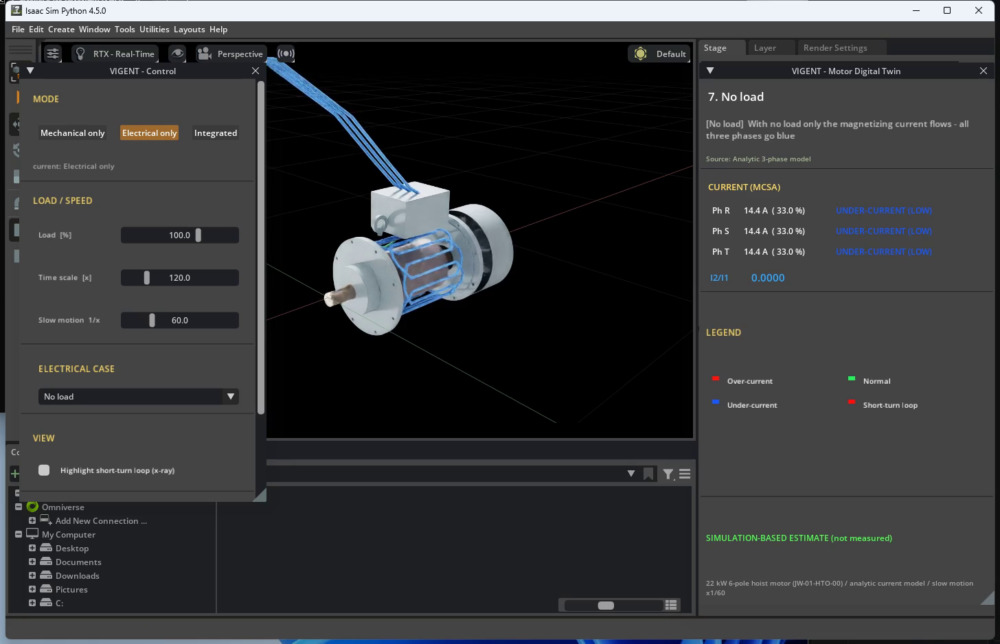

**보이는 것.** 세 케이블이 모두 파랑이고 입자가 느리다. 14.4 A(정격의 33 %), 균형은 유지되어 I₂/I₁ 0.000.
**왜.** 짐이 없으면 자석을 만드는 자화 전류만 흐른다. 결상과 달리 세 상이 고르게 낮다.
**멘트.** "이건 고장이 아닙니다. 다만 짐을 걸었는데 계속 이러면 커플링이나 로프를 의심합니다."

---

## 4. 통합 시나리오 (165초, 5장면) — 두 결함이 이어지는 이야기

파일: `3_통합/07_통합_자동재생.mp4`. 온도와 전류를 한 화면에 같이 보여주며, **전기 결함이 열 결함으로
번지는 연쇄**를 보여준다. 전류 모델이 계산한 상전류가 권선 동손(I²R)의 입력으로 들어간다.

| 장면 | 시간 | I₂/I₁ | R상 | DE 베어링 | 권선 | 무엇이 보이나 |
|---|---|---|---|---|---|---|
| 1 정상 | 0:00–0:30 | 0.006 | 44.5 A | 43 °C | 67 °C | 전부 정상, 초록 전류 |
| 2 DE 베어링 열화 | 0:30–1:10 | 0.006 | 44.5 A | **138 °C 위험** | 87 °C | 베어링만 빨강, 전류는 초록 |
| 3 ITSC 4턴 | 1:10–1:45 | **0.104** | **57.8 A** | 146 °C | 99 °C | R상이 빨강으로, 권선은 아직 정상 |
| 4 ITSC 12턴 | 1:45–2:30 | **0.269** | **88.0 A** | 154 °C | **131 °C 경고** | 과전류가 수십 초 뒤 권선 과열로 |
| 5 결론 | 2:30–2:45 | 0.269 | 88.0 A | 155 °C | 131 °C | "VIGENT 는 이 시점 이전에 경보" |

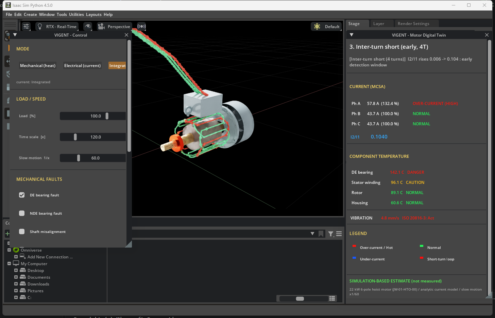

**핵심 장면은 3번이다.** 베어링은 이미 붉은데 3상 전류는 아직 초록이고, 단락이 막 시작돼 균형 지표만
움직였다. "고장이 눈에 보이기 전에 신호는 이미 나와 있다"는 주장의 근거이고, 5번 장면의 권선 과열은
그 신호를 놓쳤을 때의 결과다.

---

## 5. 리드 타임 — 사업 가치를 말하는 숫자

리드 타임은 **경보가 울린 시점부터 실제로 위험에 닿는 시점까지의 여유**다. 대시보드 차트에 주황 점선
(조기 경보)과 빨간 선(위험 도달)으로 그려져 있다.

- **기계 시나리오**: 베어링이 주의(70 °C)에 들어선 25.8 s 에 경보, 위험(95 °C)에 닿는 27.4 s 까지
  재생 시간 1.55 s — 그 구간의 배속(×120)을 적용하면 **시뮬레이션 약 3.1 분**이다. 실제 현장의 열 시정수는
  이보다 길므로 여유는 더 크다고 설명하되, 화면 숫자를 그대로 인용한다.
- **전기 시나리오**: I₂/I₁ 이 4턴 수준(0.104)에 닿는 순간과 R상이 위험 과전류(54.6 A)를 넘는 순간이
  **같다(0 s)**. 이 해석식 모델이 단락을 크기 불평형으로 등가 표현하기 때문이며, 화면에도 그렇게 적어 두었다.
  전기 쪽에서 균형 지표의 가치를 말하려면 장면 5(전압 불평형: 색은 정상, 숫자는 열 배)를 쓴다.

---

## 6. 발표 흐름 제안 (약 6분)

1. **기계 영상 장면 1→2** (50초): 정상 → 베어링만 붉어짐. "지금이 베어링만 갈면 되는 시점."
2. **대시보드 기계 차트** (40초): 주황 점선과 빨간 선 사이를 가리키며 리드 타임 설명.
3. **기계 클립 4·5** (40초): 냉각팬(전체가 붉음)과 브레이크(축이 먼저) — "패턴이 다르니 원인을 가릴 수 있다."
4. **전기 영상 장면 1→2** (45초): 초록 세 줄 → R상 빨강 + 균형 지표 17배.
5. **전기 클립 5** (25초): 색은 초록인데 숫자는 열 배 — "색만 보면 놓친다."
6. **전기 클립 6** (20초): 결상 — 한 줄 파랑, 두 줄 빨강.
7. **통합 영상 장면 3→4** (60초): 전기 결함이 열 결함으로 번지는 연쇄. "우리는 3번에서 알린다."
8. 마무리 (30초): 시뮬레이션 기반 추정값임을 밝히고, 실측 데이터 연동이 다음 단계라고 말한다.

키보드: 대시보드에서 `F` 발표 모드, `Space` 재생/정지, `←` `→` 챕터, `1`~`7` 장면 바로 이동.

---

## 7. 예상 질문과 답

**"이 온도가 실제 측정값인가요?"** — 아닙니다. 부품 9개를 각각 한 덩어리로 본 열회로 모델의 추정값이고,
화면에 항상 그렇게 표시돼 있습니다. 모델의 임계값(베어링 70/85/95 °C, 권선 95/120/140 °C)은 그리스
수명과 F종 절연 기준에서 가져왔습니다.

**"전류는 전자계 해석 결과인가요?"** — 아닙니다. 해석식 3상 모델입니다. 턴간 단락은 문헌의 목표
I₂/I₁(0.104 / 0.269)을 크기 불평형으로 재현한 등가 표현이라, 실제 단락처럼 단락 루프 순환전류가 지배하는
파형은 아닙니다. 그래서 전기 쪽 리드 타임을 0 으로 정직하게 표시했습니다.

**"베어링이 135 °C 면 이미 망가진 것 아닌가요?"** — 맞습니다. 그래서 VIGENT 는 그 훨씬 전인 70 °C(주의)
에서 경보를 냅니다. 영상은 발표 시간 안에 보여주려고 열 시뮬레이션을 60~180배 빨리 돌린 것이고,
"위험까지 가면 이렇게 된다"를 보여주는 장면입니다.

**"과전압·저전압은 왜 안 보이나요?"** — 이 영상의 빨강·파랑은 전류입니다. 전압 이상은 전류 이상의
원인 쪽입니다. 예를 들어 저전압에서는 모터가 같은 힘을 내려고 전류를 더 끌어와 오히려 빨강이 되고,
전압 불평형은 훨씬 큰 전류 불평형(장면 5)으로 나타납니다.

**"왜 결함을 하나씩만 켰나요?"** — 겹치면 손실 배율이 곱해져 물리적으로 불가능한 온도가 나오고,
무엇보다 어느 결함이 어느 부품을 달구는지 구분이 안 됩니다. 하나씩 켜야 결함마다 다른 '지문'이 보입니다.

**"2.2 kW 모터 아니었나요?"** — 이 프로젝트의 3D 모델·애니메이션·해설 대시보드는 모터 라이브러리 M1~M5(1톤 2.2 kW ~ 15~20톤 22 kW) 중
**M5(22 kW 6극, 도면 JW-01-HTO-00)** 를 기준으로 만든 것입니다. 2.2 kW 급은 M1(1톤 호이스트)로 라이브러리에 있고, 상태 보드(`#/status`)에서 같은
시나리오·같은 판정 기준으로 볼 수 있습니다. 정격 선전류 43.7 A·상전류 25.2 A 는 M5 기준이고, M1 은 4.73 A·4.73 A(Y 결선, 카탈로그) 입니다.

---

## 8. 파일 목록

```
크레인 퀀선 모터 모델링\모터결함_애니메이션\
├── 애니메이션_해설.pdf  (이 문서)
├── 1_기계적결함\  01_기계_전체시나리오.mp4  02_정상_운전  03_DE_베어링_열화  04_축_정렬_불량
│                 05_냉각팬_고장  06_브레이크_끌림  07_과부하_운전_열_관점  08_결함_해제_후_냉각
├── 2_전기적결함\  01_전기_전체시나리오.mp4  02_정상_3상_균형  03_턴간_단락_초기_4턴  04_턴간_단락_진행_12턴
│                 05_과부하_운전  06_공급전압_불평형  07_결상_R상_끊김  08_무부하_저전류
└── 3_통합\        07_통합_자동재생.mp4
```

영상 오른쪽 위의 `t 60.02s` 같은 노란 숫자는 대시보드와 시간을 맞추기 위한 타임코드다. 발표에서
거슬리면 `tools/record_mode.ps1 -Mode <mode> -NoTimecode` 로 다시 뜰 수 있다(모드당 약 6분).

수치 출처: `config/thermal.yaml`, `config/electrical.yaml`, `config/motor.yaml`,
`config/scenario_*.yaml`, 로그 `logs/<mode>/demo_*.csv`. 이 문서의 숫자를 바꿔야 한다면 config 를
바꾸고 export·테스트를 다시 돌린 뒤 여기에 반영한다 — 애니메이션·대시보드·문서의 숫자가 서로 다르면
심사 질의에서 치명적이다.
